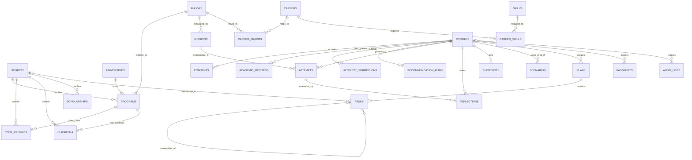
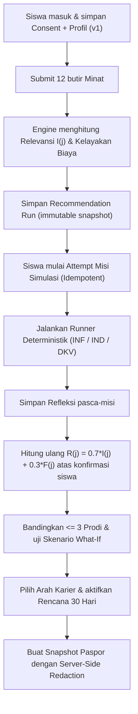

# ERD — Nexalora

- **Versi:** 1.0
- **Status:** Baseline implementasi
- **Basis:** `docs/prd.md` dan `docs/database.md`
- **Format diagram:** Mermaid ER diagram

> Diagram ini memodelkan relasi antara **Zona Katalog Publik** dan **Zona Data Privat Siswa** pada Nexalora.

## 1. ERD konseptual

## 2. ERD fisik dengan atribut utama

```mermaid
erDiagram
    SOURCES {
        uuid id PK
        string url
        string publisher
        string title
        int applicable_year
        datetime checked_at
        string review_status
    }
    MAJORS {
        string id PK
        string name
        string summary
        json heuristic_weights_json
        json prep_subjects_json
        string publication_status
    }
    UNIVERSITIES {
        string id PK
        string name
        string city_code
        string province_code
        string official_website
    }
    PROGRAMS {
        string id PK
        string major_id FK
        string university_id FK
        string name
        string campus_location
        string degree
        json admission_paths_json
        uuid source_id FK
        string publication_status
    }
    COST_PROFILES {
        uuid id PK
        string program_id FK
        int academic_year
        string admission_track
        string housing_mode
        string version
        json components_json
        uuid source_id FK
    }
    CURRICULA {
        uuid id PK
        string program_id FK
        int curriculum_year
        string version
        json rules_json
        uuid source_id FK
    }
    SCHOLARSHIPS {
        string id PK
        string name
        string organizer
        string aid_type
        json scope_json
        json benefits_json
        json dates_json
        string status
        uuid source_id FK
    }
    MISSIONS {
        string id PK
        string mission_version
        string engine_version
        string major_id FK
        string title
        json config_json
        string reviewer_name
        string publication_status
    }
    CAREERS {
        string id PK
        string title
        string summary
        json activities_json
        string reviewed_by
        json source_ids_json
        string publication_status
    }
    SKILLS {
        string id PK
        string name
        string description
    }
    CAREER_MAJORS {
        string career_id PK, FK
        string major_id PK, FK
        string mapping_reason
    }
    CAREER_SKILLS {
        string career_id PK, FK
        string skill_id PK, FK
    }
    PROFILES {
        uuid user_id PK
        string display_name
        string grade_level
        int graduation_year
        string city_code
        string province_code
        string relocation_mode
        int monthly_budget_min
        int monthly_budget_max
        int upfront_budget_max
        string housing_mode
        json pinned_programs_json
        int version
    }
    CONSENTS {
        uuid id PK
        uuid user_id FK
        string purpose_version
        boolean is_accepted
        datetime consented_at
    }
    ACADEMIC_RECORDS {
        uuid id PK
        uuid user_id FK
        string subject
        int semester
        float score
        string scale
    }
    INTEREST_SUBMISSIONS {
        uuid id PK
        uuid user_id FK
        string instrument_version
        json answers_json
        datetime submitted_at
    }
    RECOMMENDATION_RUNS {
        uuid id PK
        uuid user_id FK
        int profile_version
        string rule_version
        string catalog_version
        json inputs_snapshot_json
        json results_json
        datetime created_at
    }
    ATTEMPTS {
        uuid id PK
        uuid user_id FK
        string mission_id FK
        string mission_version
        string seed
        string status
        json artifact_json
        json result_json
        int revision
        int last_run_revision
        string idempotency_key
    }
    REFLECTIONS {
        uuid id PK
        uuid user_id FK
        uuid attempt_id FK
        int revision
        json responses_json
        boolean is_active
    }
    SHORTLISTS {
        uuid user_id PK, FK
        json program_ids_json
        int base_version
    }
    SCENARIOS {
        uuid id PK
        uuid user_id FK
        int base_profile_version
        json overrides_json
        json results_json
    }
    PLANS {
        uuid id PK
        uuid user_id FK
        json goal_ids_json
        int weekly_minutes
        date start_date
        int version
        string status
        string idempotency_key
    }
    TASKS {
        uuid id PK
        uuid plan_id FK
        uuid prerequisite_task_id FK
        string title
        string action_type
        int estimated_minutes
        date due_date
        string status
        string evidence_note
        string evidence_url
        uuid source_id FK
        int version
    }
    PASSPORTS {
        uuid id PK
        uuid owner_id FK
        json snapshot_json
        json redactions_json
        datetime created_at
    }
    AUDIT_LOGS {
        uuid id PK
        uuid user_id
        string event_name
        string request_id
        json metadata_json
        datetime created_at
    }

    SOURCES ||--o{ PROGRAMS : verifies
    SOURCES ||--o{ COST_PROFILES : verifies
    SOURCES ||--o{ CURRICULA : verifies
    SOURCES ||--o{ SCHOLARSHIPS : verifies
    MAJORS ||--|{ PROGRAMS : offered_as
    UNIVERSITIES ||--|{ PROGRAMS : hosts
    PROGRAMS ||--o{ COST_PROFILES : has
    PROGRAMS ||--o{ CURRICULA : has
    MAJORS ||--o{ MISSIONS : has
    MAJORS ||--o{ CAREER_MAJORS : maps
    CAREERS ||--o{ CAREER_MAJORS : maps
    CAREERS ||--o{ CAREER_SKILLS : maps
    SKILLS ||--o{ CAREER_SKILLS : maps
    PROFILES ||--o{ CONSENTS : has
    PROFILES ||--o{ ACADEMIC_RECORDS : has
    PROFILES ||--o{ INTEREST_SUBMISSIONS : has
    PROFILES ||--o{ RECOMMENDATION_RUNS : has
    PROFILES ||--o{ ATTEMPTS : has
    PROFILES ||--o{ REFLECTIONS : has
    PROFILES ||--o| SHORTLISTS : has
    PROFILES ||--o{ SCENARIOS : has
    PROFILES ||--o{ PLANS : has
    PROFILES ||--o{ PASSPORTS : has
    MISSIONS ||--o{ ATTEMPTS : runs
    ATTEMPTS ||--o{ REFLECTIONS : has
    PLANS ||--|{ TASKS : has
    TASKS o|--o{ TASKS : prereq
    SOURCES o|--o{ TASKS : cites
```

## 3. Alur data ringkas

## 4. Definition of Done ERD

- [ ] Seluruh 25 entitas/tabel penghubung di ERD selaras dengan `docs/database.md` dan `prisma/schema.prisma`.
- [ ] Semua tabel privat memiliki relasi kepemilikan ke `PROFILES` (`user_id` / `owner_id`).
- [ ] Relasi *many-to-many* (`CAREER_MAJORS`, `CAREER_SKILLS`) memakai tabel penghubung eksplisit.
- [ ] Semua fakta kampus (`PROGRAMS`, `COST_PROFILES`, `CURRICULA`, `SCHOLARSHIPS`) terhubung ke `SOURCES`.